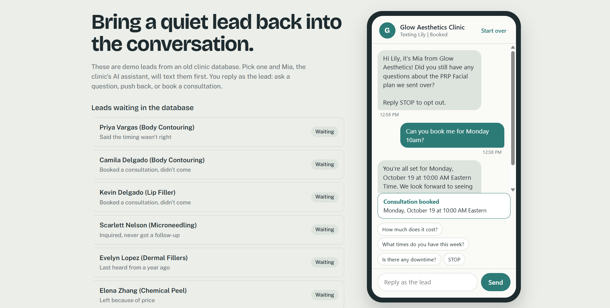

# Case study: winning back a dormant clinic database with AI conversations

**Demo business:** Glow Aesthetics Clinic (fictional)  
**What I built:** an end-to-end reactivation system in n8n, Supabase, and Gemini  
**Status:** working demo. Results shown are simulated sample data.

- Results dashboard: https://glow-aesthetic-clinicdashboard.netlify.app
- Code and setup: the repository this file lives in

## The problem

A medical aesthetic clinic had more than 400 old leads sitting in a spreadsheet. The team had no follow-up system, so they called people by hand and never got through the list. Most of those leads weren't lost. They had asked about a treatment, got a quote or missed an appointment, and then went quiet. A mass text would have been the quick fix, but a generic blast to an old list gets ignored, annoys people, and creates opt-out and compliance trouble.

## The approach

Three ideas shaped the build:

1. **Start a conversation, not a campaign.** Each lead gets a short text written for their situation (a missed consultation, a quote they never answered, a price concern), and the AI handles whatever they say back.
2. **Let the AI talk, and let code make the rules.** Opt-outs, send windows, daily limits, and booking checks are enforced by the system, not left to the AI's good behavior.
3. **Keep the strategy in data.** The tone, follow-up timing, and number of nudges for each type of lead live in a table. Changing the campaign doesn't mean editing workflows.

## How a lead moves through the system

1. **Clean and segment.** A messy export of 474 rows became 446 clean leads after fixing phone formats, removing duplicates, and excluding do-not-contact leads. They were sorted into six segments.
2. **First text.** A scheduler picks one lead at a time, only during that lead's local daytime hours and under a daily cap. The AI writes a two-sentence opener and adds the opt-out line.
3. **Conversation.** Replies go to an AI agent that remembers the whole thread. It answers questions, offers real open times, and books the consultation on the sales calendar.
4. **Follow-ups.** Silent leads get up to two nudges, each with a fresh angle. After that they are marked cold and left alone.
5. **Handoff.** If a lead opts out or a person takes over, the AI goes quiet.

## Where it could have gone wrong, and how I handled it

- **The AI confirmed a booking it never made.** In testing, the model sometimes replied "you're all set" without calling the booking tool. I added a database check that compares each reply against the bookings table. A false confirmation is replaced with a safe message and logged as an incident.
- **Double-booking.** A database rule makes it impossible for two leads to hold the same slot, even if two conversations try at once.
- **Mixed-up memory.** An early bug stored every lead's conversation under one shared key, so the AI answered the wrong person's questions. I found it by inspecting the memory table and fixed the key, and it is the reason each lead's history is now kept separate.
- **Public demo safety.** Only leads flagged as demo can be reached by the public endpoints, so a visitor can't start conversations with the rest of the database.

## Results (simulated sample data)

I generated two weeks of sample campaign activity across the 432 reachable leads to show what the reporting looks like. These are not client results.

| Measure | Sample result |
|---|---|
| Dormant leads in the campaign | 432 |
| Leads texted | 344 |
| Replied | 74 (about 21% of those texted) |
| Consultations booked | 31 (about 9% of those texted) |
| Booked treatment value | about $35,700 |
| Opted out | about 1.5% of those texted |

Reply rates varied by lead type in the sample: leads who missed a consultation or went quiet after a quote responded most, and year-old inquiries responded least.

## What I would do next on a real engagement

- Connect a live channel. The demo runs in a chat page. The same pipeline sits behind SMS, email, or WhatsApp, with a lookup from phone number or email to lead.
- Confirm consent for the old list, register for business texting where required, and honor opt-outs and quiet hours.
- Handle larger batches, alert on failed runs, and add booking cancellation and rescheduling.
- Replace the sample numbers with a real two-week pilot on a slice of the client's database.

## Tools

n8n, Supabase (Postgres), Google Gemini, Google Calendar, Netlify. All on free tiers.
