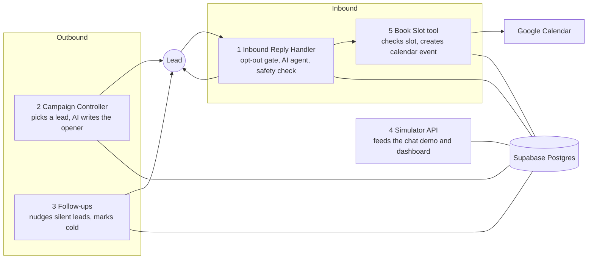

# Dead Lead Reactivation: AI conversations that win back a dormant database

An n8n system that goes through an old clinic database, sorts the leads into segments, and starts a **personalized two-way text conversation** with each one. An AI assistant answers questions, handles objections, and **books consultations on the sales team's calendar**. It is not a blast: every lead gets its own message, and replies are handled one conversation at a time.

Demo business: *Glow Aesthetics Clinic* (fictional). All data is fake.

**Live demos**
- Results dashboard: https://glow-aesthetic-clinicdashboard.netlify.app
- Chat demo (pick a lead, watch the AI text first, reply as the lead): ADD YOUR CHAT DEMO LINK HERE
- Short walkthrough video: ADD YOUR LOOM LINK HERE

## The problem

A clinic had 400+ old leads and no follow-up system. The team called them by hand and never got through the list. Most of that database was warm demand that had simply gone quiet.

## What the system does

1. **Cleans and segments the database.** Fixes phone formats, removes duplicates and do-not-contact leads, then sorts leads into six segments (missed a consultation, went quiet after a quote, left over price, bad timing, never followed up, year-old inquiry).
2. **Starts each conversation.** A scheduler picks one lead at a time, inside that lead's local daytime hours and under a daily cap. The AI writes a short opener using that segment's messaging approach.
3. **Holds the conversation.** Replies go through an AI agent with memory per lead. It answers questions, offers real open times, and books the consultation.
4. **Follows up without nagging.** Silent leads get up to two nudges with a fresh angle each time, then are marked cold.
5. **Reports results.** A dashboard shows the funnel, results by segment, and daily activity.

## Architecture



| Workflow | Job |
|---|---|
| 1 Inbound Reply Handler | Receives a message, applies opt-out and human-takeover gates, runs the AI agent (tools: free slots, book appointment), checks the reply for false confirmations, logs everything |
| 2 Campaign Controller | Claims the next lead with `claim_next_batch()`, writes and saves the opener |
| 3 Follow-ups | Finds leads due for a nudge, writes it, schedules the next one, marks leads cold |
| 4 Simulator API | Endpoints for the chat demo and the dashboard (list leads, read a thread, reset, stats) |
| 5 Book Slot | Re-checks the slot, creates the calendar event, saves the booking |

## Design decisions worth reading

- **Rules live in code, not in the AI's good behavior.** Opt-out (STOP) is caught before the AI sees the message. A database check blocks any reply that claims a booking when none exists, and the incident is logged. Double-booking is prevented by a unique index in the database.
- **The messaging approach is data.** Each segment's tone and angle, follow-up timing, and number of nudges sit in a `segment_playbook` table, so changing the campaign doesn't mean editing workflows.
- **Safe scheduling.** A single function enforces a kill switch, a daily cap, each lead's local send window, and row locking so overlapping runs can't text the same lead twice.
- **Public demo is fenced in.** Only leads flagged `is_demo` can be reached by the public endpoints.
- **Honest AI.** The assistant never invents prices or availability and says it is the clinic's AI assistant if sincerely asked.

## Stack (all free tier or self-hosted)

n8n, Supabase (Postgres), Google Gemini API (free tier), Google Calendar, Netlify.

## Results

The dashboard shows **simulated sample results** (a reply rate near 21% and a booking rate near 9% across 432 leads over two weeks), generated by `database/06_sample_campaign.sql`, to show what the reporting looks like. These are not client results. The chat demo conversations are live.

## Run it yourself

1. Create a Supabase project. In the SQL editor run, in order: `01_schema.sql`, import `leads_raw.csv` into `leads_staging`, then `03_clean_and_segment.sql`, `04_security.sql`, `05_booking_and_demo.sql`, and optionally `06_sample_campaign.sql`.
2. In n8n, add credentials for Postgres (Supabase session pooler), Google Gemini, and Google Calendar. Import the five workflow files from `workflows/` and reselect the credentials in each node.
3. Publish workflows 1, 2 (start path only), 4, and 5. Leave the schedule triggers off unless you are running a real campaign. `campaign_settings.is_active` is the kill switch.
4. Deploy `demo/dashboard.html` and `demo/simulator.html` to any static host and set their `API` address to your n8n webhook base.

## What changes in production

- **Channel:** the demo channel is a browser chat page. In a live system the same pipeline sits behind Twilio (SMS), Gmail or SMTP (email), or WhatsApp. It needs a lookup from phone or email to lead, and SMS needs carrier registration (A2P 10DLC in the US).
- **Compliance:** confirm consent before contacting an old list, honor opt-outs and do-not-call lists, and respect quiet hours.
- **Scale:** process batches with a loop, add alerting for failed runs, and add cancellation and rescheduling of bookings.

## Files

```
database/   SQL (01 to 06), demo data generator, raw CSV
workflows/  n8n workflow exports (JSON)
demo/       chat demo and results dashboard (static pages)
docs/       case study and screenshots
```
